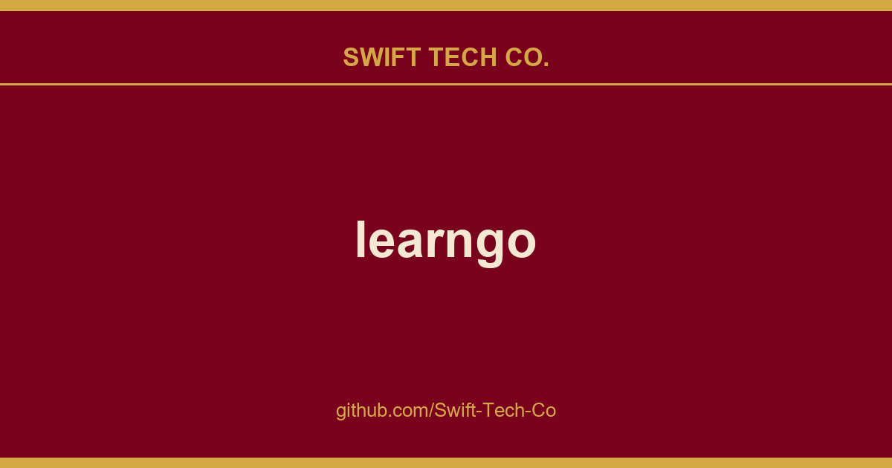

# learngo

## What This Is

A practical reference entry for product and engineering: the learngo notes, examples and fixes we reach for repeatedly. Kept current as part of the wider Swift Tech Co. engineering library.

## Images

## ❤️ Help other fellow developers

## Stay in touch

  _I usually tweet Go tips and tricks._

* **Subscribe to my newsletter**

  _Get updates from me._

  _Followed by 5K+ developers, and contains dozens of illustrated articles about Go._

* **Watch my Youtube channel**

---

## License
Whole materials are licensed under the <a rel="license" href="https://github.com/Swift-Tech-Co/learngo">Creative Commons Attribution-NonCommercial-ShareAlike 4.0 International License</a>. 

---

## Swift Tech Co.

Built and maintained by Swift Tech Co.

AI Automation | FinTech Platforms | Custom Software and Mobile Apps | SaaS Platforms | Cloud Infrastructure | Cybersecurity | SEO and Marketing | API Integration

**Join our community on Telegram:** [t.me/+Qt_eFvkb2rliMzNh](https://t.me/+Qt_eFvkb2rliMzNh)

Home | Services | Careers | Referral Program | Influencers | About | Contact

**Connect**

- Website: https://github.com/Swift-Tech-Co/learngo
- LinkedIn: [linkedin.com/in/stephenoladoke](https://www.linkedin.com/in/stephenoladoke/)
- LinkedIn (Company): [linkedin.com/company/swift-tech-co](https://www.linkedin.com/company/swift-tech-co)
- X: [@MrOladoke](https://x.com/MrOladoke)
- Instagram: [@mr.oladoke](https://www.instagram.com/mr.oladoke/)
- Organization: [github.com/Swift-Tech-Co](https://github.com/Swift-Tech-Co)

## Sources

Compiled and maintained from upstream [inancgumus/learngo](https://github.com/inancgumus/learngo) under permissive open-source license.

---

Maintained by [Swift Tech Co.](https://github.com/Swift-Tech-Co) - [Telegram](https://t.me/+Qt_eFvkb2rliMzNh)

## Sources

Compiled and maintained from upstream [inancgumus/learngo](https://github.com/inancgumus/learngo) under permissive open-source license.

---

Maintained by [Swift Tech Co.](https://github.com/Swift-Tech-Co) - [Telegram](https://t.me/+Qt_eFvkb2rliMzNh)

## Sources

Compiled and maintained from upstream [inancgumus/learngo](https://github.com/inancgumus/learngo) under permissive open-source license.

---

Maintained by [Swift Tech Co.](https://github.com/Swift-Tech-Co) - [Telegram](https://t.me/+Qt_eFvkb2rliMzNh)

## Sources

Compiled and maintained from upstream [inancgumus/learngo](https://github.com/inancgumus/learngo) under permissive open-source license.

---

Maintained by [Swift Tech Co.](https://github.com/Swift-Tech-Co) - [Telegram](https://t.me/+Qt_eFvkb2rliMzNh)